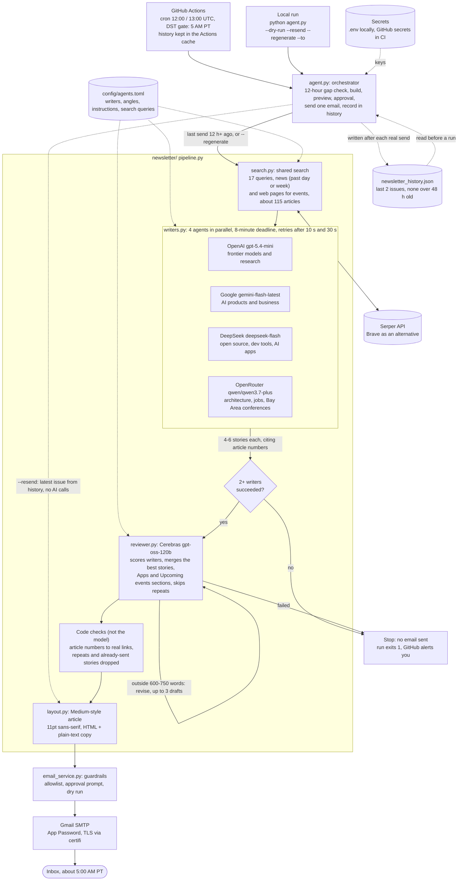

# Newsletter Agent Architecture

Every morning at 5:00 AM Pacific, four writer agents draft stories from a shared news search, a review agent turns the best of them into one 600–750 word article, and a single email goes out through Gmail. One config file defines the agents and their instructions, and a small history file keeps sends 12 hours apart and stops stories repeating.

## Diagram

Solid arrows are the normal path. Dotted arrows are configuration, history and the resend path.

## How a run works

1. GitHub Actions starts at 12:00 and 13:00 UTC. A daylight saving check lets only the 5:00 AM Pacific run continue, and the sent-email history is restored from the Actions cache.
2. `agent.py` reads the history. If the last email went out less than 12 hours ago, it stops here and sends nothing, unless the run was started with `--regenerate`.
3. `search.py` runs the queries in `config/agents.toml`: news searches over the past day or week, plus web searches for upcoming Bay Area events. It numbers the unique results, typically about 115.
4. The enabled writers in `agents.toml` run at the same time, each with its own angle, and return 4–6 stories that cite article numbers. Writers whose angle covers apps or events add those stories; all of them skip recent headlines.
5. If at least two writers succeed, the Cerebras reviewer scores them and writes one issue from the best stories, with Apps and Upcoming events sections when writers supply them, avoiding anything the last two emails covered.
6. Code swaps article numbers for real links, drops repeats and already-sent stories, and counts words. Drafts outside 600–750 words go back for revision.
7. `layout.py` turns the issue into a Medium-style article; `email_service.py` sends it through Gmail, and the issue is saved to history.

## When it sends, and when it doesn't

| Situation | Result |
| --- | --- |
| 4, 3 or 2 writers succeed | **Sends** one email |
| Last email under 12 h ago | Skips before any API call; exits normally |
| `--regenerate` | **Sends** a fresh issue now, ignoring the gap, and replaces the latest one in history |
| `--resend` | **Sends** the latest issue again in the current layout; no AI calls, gap not applied |
| Provider busy or unreachable | Retried after 10 s, then 30 s |
| Writer still running at 8 min | Skipped; the others continue |
| 0 or 1 writers succeed | **No email**, run fails |
| Fewer than 8 articles found | **No email**, run fails |
| Reviewer fails, or length stays far off | **No email**, run fails |
| `config/agents.toml` has a mistake | **No email**, run fails before any API call |

## Components

| File | Role | External service |
| --- | --- | --- |
| `agent.py` | Entry point: 12-hour gap, preview, approval prompt, a single send, resend, regenerate, exit code | None |
| `config/agents.toml` | Writer roster and angles, search queries, and every instruction the agents follow | None |
| `newsletter/agents.py` | Loads and validates `agents.toml`; stops the run on any mistake | None |
| `newsletter/config.py` | Providers and runtime settings, read from environment variables | None |
| `newsletter/history.py` | Last 2 sent issues with UTC timestamps; deletes anything over 48 hours old | None (a JSON file; Actions cache in CI) |
| `newsletter/search.py` | Shared news and web search with duplicate removal | Serper (or Brave) |
| `newsletter/llm.py` | One JSON call to any OpenAI-compatible API, with timeouts and retries | All five model providers |
| `newsletter/writers.py` | Writer agents in parallel, each with an editorial angle | OpenAI, Google, DeepSeek, OpenRouter |
| `newsletter/reviewer.py` | Ranking, merging, Apps and events sections, repeat checks, length control | Cerebras |
| `newsletter/layout.py` | Medium-style HTML article and its plain-text copy | None |
| `newsletter/pipeline.py` | Runs the steps and decides whether the result is fit to send | None |
| `email_service.py` | Allowlist, dry run, HTML and plain-text email | Gmail SMTP |

## Configuration

- **`config/agents.toml`**: what the agents do. Writers, angles, search queries and every instruction.
- **Environment variables** (`.env` locally, GitHub secrets in CI): keys, models, timeouts, word range, history size and the 12-hour gap. See `.env.example`.

Neither needs a code change.
